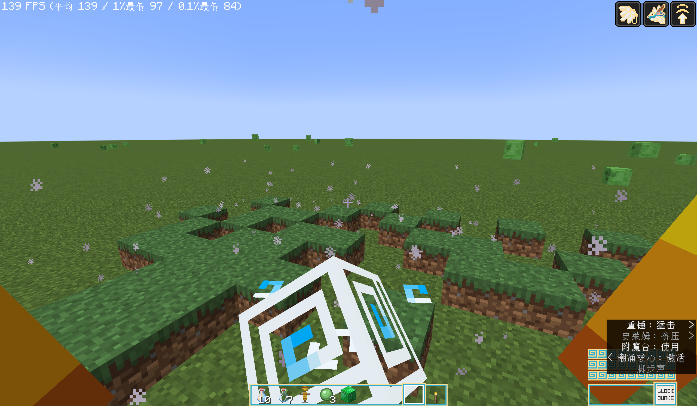
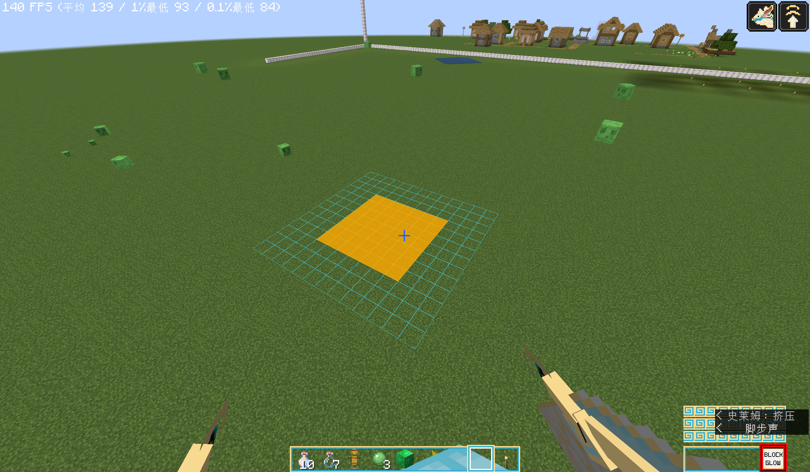

# Block Effects (`block_effect`)

> Applies to: Additional Abilities for DS `2.0.0` · Dragon Survival `≥ 2.0.71`
> Location: `actions[].target_selection.applied_effects.block_effect[]`

A block effect lives inside the `applied_effects.block_effect[]` array. Each element selects its type with
`effect_type`, and that type's own fields sit **next to** `effect_type`:

```jsonc
"applied_effects": {
  "block_effect": [
    { "effect_type": "additional_abilities:block_quake", /* ← fields go here */ }
  ]
}
```

---

## `additional_abilities:block_quake` — Block Quake

**In one sentence**: makes the selected blocks hop into the air like a ground slam, then settle back down.



### Fields

| Field | Type | Required | Default | Notes |
|---|---|---|---|---|
| `amplifier` | level value | ❌ | `0.5` | Height multiplier, see the conversion below |
| `probability` | level value | ❌ | `1.0` | Chance to take effect, **rolled independently for every block** |
| `valid_blocks` | block predicate | ❌ | match everything | Same format as Dragon Survival's other block effects |
| `sound` | sound id | ❌ | silent | Played when the blocks hop. Write the registry id string directly |

### Height conversion

```
hop height (blocks) = min(3.0, 0.5 × amplifier)
```

| `amplifier` | 0.5 | 1.0 | 2.0 | 6.0 and above |
|---|---|---|---|---|
| Height | 0.25 blocks | 0.5 blocks | 1.0 blocks | 3.0 blocks (capped) |

The hop duration grows with the square root of the height (higher hops take longer) and is automatically
clamped to **6 – 24 ticks**, so there is nothing to tune by hand.

### Example

```json
"block_effect": [
  {
    "effect_type": "additional_abilities:block_quake",
    "amplifier": { "type": "minecraft:linear", "base": 0.5, "per_level_above_first": 0.25 },
    "probability": 0.35,
    "valid_blocks": { "type": "minecraft:matching_block_tag", "tag": "minecraft:dirt" },
    "sound": "minecraft:item.mace.smash_ground"
  }
]
```

### Things to know

- **Purely visual, it does not modify the world.** The hopping blocks are client-side dummies; they
  **do not collide, are not saved, and do not drop**, and there are no neighbour updates or lighting
  changes. Safe to use over large areas.
- **There is a filter chain**, and anything filtered out simply will not move (the order is also the cost order):
  1. the probability roll;
  2. the `valid_blocks` predicate;
  3. air is excluded;
  4. **only full-collision blocks are kept** — slabs, stairs, torches, grass and fluids look wrong when
     lifted a full block, so they are filtered out too;
  5. **surface check** — anything with an occluding or fluid block above it is skipped.
- Points 4 and 5 mean **blocks under water or buried underground never hop**. That is deliberate
  visual polish, not a bug.
- `sound` uses the same format as `activation.sound` in Dragon Survival ability JSON: just write the sound
  registry id. Custom sounds work too, as long as they are registered under `minecraft:sound_event`.
  Playback details:
  - **It fires once per ability action**, with the sound source placed at the **geometric centre** of the
    batch — a large quake lifts dozens of blocks at once, and playing per block would stack dozens of
    sources into an audible blast rather than a single "slam";
  - **A "batch" is delimited by the ability action**: every block lifted by one cast shares one sound
    source. Different players, different abilities, and **two independent casts of the same ability by
    the same player** (e.g. two overlapping domains) each get their own sound, positioned over their
    own blocks.
    (The visual side still merges across casters, and the two are independent — two distant quakes are
    never given a sound source halfway between them, where neither would be audible.)
  - Volume and pitch are the Vanilla defaults of `1.0` (audible radius roughly 16 blocks) and
    **do not scale with `amplifier`**;
  - It is broadcast server-side, so **the caster hears it too**.
- **Throttling is built in**, so a high `trigger_rate` will not turn the terrain into a seizure:
  - **Position cooldown**: the same coordinate only quakes once every 10 ticks;
  - Triggers within the same tick are merged into as few network packets as possible and only sent to
    nearby players.
  - The cooldown records and the pending buffer live on **each dimension's own data** and are reclaimed with
    the world instance — so a save change cannot leave the cooldown test using the previous world's timestamps
    (which would otherwise keep rejecting quakes at the same coordinates for a long time).
- **Changing dimension clears the fake blocks immediately**: as soon as the client sees a different world
  instance (dimension change, return to the main menu) every fake block is dropped, **without waiting for a
  packet from the new dimension** — so they never keep bouncing in the old world.
- This effect only moves the **shape** of the blocks and **deals no damage**. Add a `dragonsurvival:damage`
  style entity effect for that, and remember to use a **separate action** — entity effects and block
  effects cannot live in the same `applied_effects`.

---

## `additional_abilities:extinguish` — Extinguish

**In one sentence**: snuffs out whatever is **burning** on the selected block — the mirror of Dragon Survival's
built-in `dragonsurvival:fire`.

### Fields

| Field | Type | Required | Default | Notes |
|---|---|---|---|---|
| `extinguish_probability` | level value | ❌ | `1.0` | **Applies to fire blocks only** (`fire` / `soul_fire`); campfires and candles are always put out |

### What it puts out

The order matches vanilla's splash water bottle (`ThrownPotion#dowseFire`) exactly, and the three cases are
mutually exclusive (the first hit returns):

| # | Target | Behaviour |
|---|---|---|
| 1 | Fire: `minecraft:fire` / `minecraft:soul_fire` (the `#minecraft:fire` tag) | Removed on the `extinguish_probability` roll (**no drops**) |
| 2 | Lit candle / candle cake | `lit=false`, smoke particles and the `CANDLE_EXTINGUISH` sound |
| 3 | Lit campfire / soul campfire | `lit=false`, cooking stopped (`CampfireBlockEntity#dowse`) and the `FIRE_EXTINGUISH` sound |

### How it mirrors `dragonsurvival:fire`

| `dragonsurvival:fire` branch | `extinguish` counterpart |
|---|---|
| TNT → ignite | **none** — an ignited TNT cannot be called off |
| Unlit campfire → light it | Lit campfire → put it out |
| `snowy` block → clear the snow | **none** — "adding snow" has nothing to do with extinguishing |
| Air + probability → place fire | Fire block + probability → remove it |
| (none) | Candle / candle cake → extinguish **(added by this effect)** |

The structure mirrors as well: **only the "place fire / put out fire" branch is gated by probability**, the
special branches are not.

### Example

```json
"block_effect": [
  {
    "effect_type": "additional_abilities:extinguish",
    "extinguish_probability": 1.0
  }
]
```

### Things to know

- **Vanilla has no "extinguish" API.** MC 1.21.1 offers no method that puts out a fire block
  (`FireBlock` / `BaseFireBlock` have no `extinguish`), so this effect copies vanilla's splash water bottle
  handling — sound, particles and the `BLOCK_CHANGE` game event included.
- Fire is removed with `destroyBlock(pos, false, dragon)` and **drops nothing** (fire has no loot table).
- **`direction` takes no part in any check**, so it is immune to the "`direction` is usually null" caveat.
- The sidebar only appends "with a x% chance" when the probability is **below 100%**.
- Division of labour with the built-ins: `dragonsurvival:block_break` can only break fire and is silent;
  `dragonsurvival:conversion` can only map one block state to another (campfire → unlit campfire). To
  "put out every fire in an area", use this effect — it covers fire, campfires and candles at once.

---

## `additional_abilities:glow` — Block Glow

**In one sentence**: makes the selected blocks **glow** — every player within view distance sees the same spot,
in the same colour, for the same duration.



### Fields

| Field | Type | Required | Default | Notes |
|---|---|---|---|---|
| `color` | colour | ✅ | — | Vanilla `TextColor`: one of 16 colour names, or `#RRGGBB` — see below |
| `alpha` | `0.0` – `1.0` | ❌ | `1.0` | Opacity. `0` means invisible and is skipped outright |
| `display_type` | enum | ❌ | `outline` | `outline` (wireframe) / `simple_shader` (the whole block tinted) |
| `duration` | level value | ❌ | `60` (3s) | Glow duration in ticks, clamped to **1 – 1200** |
| `probability` | level value | ❌ | `1.0` | Chance to take effect, **rolled independently for every block** |
| `valid_blocks` | block predicate | ❌ | match everything | Same format as Dragon Survival's other block effects |
| `hide_occluded` | boolean | ❌ | `true` | Whether to drop fully occluded blocks. **`simple_shader` only** |

### How to write the colour

| Form | Examples |
|---|---|
| Colour name (16 of them, all lowercase) | `"aqua"` / `"dark_purple"` / `"light_purple"` / `"gold"` … |
| Hex | `"#3FD9FF"` |

The 16 names are `black` `dark_blue` `dark_green` `dark_aqua` `dark_red` `dark_purple` `gold` `gray`
`dark_gray` `blue` `green` `aqua` `red` `light_purple` `yellow` `white`.

> ⚠️ **Two traps**:
> 1. The `#` branch parses the text as a **hex integer**, **not** as CSS shorthand — `"#FFF"` is `0x000FFF`
>    (a near-black blue), not white. **Always write all six digits.**
> 2. **`color` itself carries no alpha** (an eight-digit `#AARRGGBB` is out of range and errors out).
>    For transparency use the separate `alpha` field.

### The two display types

| `display_type` | Look | Cost per block | Filtering applied |
|---|---|---|---|
| `outline` | A wireframe along the block's edges — as if the block itself were alight | **A fixed 12 edges**, independent of block shape | Distance (64 blocks) + frustum |
| `simple_shader` | The whole block model tinted with the colour | Re-bakes the block model every frame — noticeably more expensive | Distance (32 blocks) + frustum + **occluded / non-full-shaped blocks never even leave the server** |

`outline` **uses the depth test**: whatever is hidden behind another block stays hidden — it reads as "the block
is glowing", **not** as X-ray.

### Example

```json
"block_effect": [
  {
    "effect_type": "additional_abilities:glow",
    "color": "#3FD9FF",
    "alpha": 0.85,
    "display_type": "outline",
    "duration": { "type": "minecraft:linear", "base": 40.0, "per_level_above_first": 20.0 },
    "valid_blocks": { "type": "minecraft:matching_block_tag", "tag": "minecraft:ores" }
  }
]
```

### Things to know

- **This is not `dragonsurvival:glow`** (and that is the point of the effect):
  - Dragon Survival's `glow` is an **entity effect** — the state lives on the **player**, and the client only
    outlines **that player's own dragon model**, so the glow follows the player and only they see it;
  - this effect is a **block effect** — the target is a block coordinate, synced from the server to nearby
    players, so the glow is pinned to the world and anyone passing by sees it.
- **How it relates to `dragonsurvival:block_vision`** (the ore vision ability): that system already implements
  `outline` / `simple_shader`, but it is a **client-side local scan** attached to a player and never sent over
  the network. This effect reuses its **rendering** and replaces its **sync and lifetime** semantics.
- **Purely visual, it does not modify the world**: no `setBlock`, no lighting writes, no neighbour updates —
  it **does not affect the actual block light level**.
- **Overlapping works**: different colours / display types are separate entries on the server and are drawn
  separately on the client, so different casts and different players stack naturally instead of overriding each
  other. (Same colour and same type merge into one entry — visually indistinguishable anyway.)
- **What merges is the display, not the duration**: casters that share one entry each keep **their own expiry
  tick**, and the entry as a whole lives until the latest of them. Therefore:
  - if A contributes 1200 ticks and B contributes 20, B's share is dropped after 20 ticks and does not drag the
    entry along with it;
  - when `/additional-abilities block-glow clear` removes A and B has already expired, the **entry is genuinely
    removed**, so the count the command reports matches what actually disappeared.
- **The lifetime is self-managed**: the block effect interface has no `remove` (block effects are instantaneous),
  so this effect keeps its own clock — the server re-sends every live entry once every 20 ticks to "keep it
  alive", and the client counts down locally from the remaining duration carried in the packet. A repeatedly
  triggered ability stays lit; once it stops, the glow expires on its own. The trade-off: **if the ability is
  interrupted early, the glow lingers until `duration` runs out.**
- **State belongs strictly to the current world**: the server keeps live entries on **each dimension's own
  data**, and the client keeps entries only for the **current world instance** —
  - **No bleed between saves**: entries are created and reclaimed together with the world instance, so
    "enter save A with a large game time, quit, then enter save B with a smaller one" cannot let A's leftover
    timestamps affect B (which would otherwise stop new glows at the same coordinates from showing for a long
    time);
  - **Changing dimension clears immediately**: as soon as the client sees a different world instance
    (dimension change, return to the main menu) the whole table is dropped, **without waiting for a packet from
    the new dimension** — so old coordinates are neither drawn nor counted down any further.
- **The occlusion filter serves `simple_shader` only**: it asks whether **all six** neighbouring blocks are
  solid-rendered — a strict definition of "completely occluded", so visible blocks are never dropped by mistake.
  `outline` skips this filter: its cost is independent of visibility, and with the depth test on the GPU hides
  the covered edges for free. Set `hide_occluded` to `false` for an "X-ray ore finding" style effect.
- **Sidebar**: extra notes are appended only when the probability is below 100%, `alpha` is below 1.0, or
  `valid_blocks` is not "match everything".
### Client config (visibility distance)

How far the glow is **drawn** is a client-side setting. It lives in the `[block_glow]` section of
`config/additional_abilities-client.toml`, or you can edit it in-game under "Mods -> Additional Abilities for DS
-> Config". **It takes effect immediately, no restart needed.**

| Option | Default | Notes |
|---|---|---|
| `block_glow.outline_distance` | `64.0` | Visibility distance of the wireframe channel (blocks), range `8 - 64` |
| `block_glow.shader_distance` | `32.0` | Visibility distance of the tint channel (blocks), range `8 - 64`. **Lower this one first if the frame rate suffers** |

Two things to keep in mind:

- **The 64 ceiling is not arbitrary**: the server decides "who receives the glow packets" using a fixed margin,
  and it **cannot read** this client-side config (client configs are not loaded on a dedicated server at all).
  The config ceiling is therefore pinned to the server's broadcast margin (`BlockGlows.VIEW_MARGIN`) —
  **you can only lower it, never raise it**, which structurally rules out the silent truncation where
  "the client wants to draw but the server never sent the packet".
- Lowering it affects **only what you see** — not other players, not the glow's duration, and not any
  server-side behaviour.

---

## `additional_abilities:redstone_powering` — Redstone Powering

**In one sentence**: gives the selected blocks a **virtual redstone input** — vanilla redstone wire, repeaters, lamps and pistons react as usual, yet no redstone-source block ever appears in the world.

### Fields

| Field | Type | Required | Default | Notes |
|---|---|---|---|---|
| `power` | level value | ✅ | — | Redstone signal strength, rounded and clamped to **0 - 15** |
| `target_direction` | direction | ❌ | omitted = direct activation | Reuses Dragon Survival's `TargetDirection`, see below |
| `probability` | level value | ❌ | `1.0` | Chance to take effect, **rolled independently for every target block** |
| `valid_blocks` | block predicate | ❌ | match everything | The effect's own block filter; Dragon Survival's `target_conditions` still runs first |
| `pulse_duration` | level value | ❌ | `1` tick | How long the supply lasts, clamped to **1 - 20** ticks |

### Writing `target_direction`

```json
"target_direction": { "direction": "north" }          // fixed direction
"target_direction": { "direction": "looking_at" }     // nearest axis of the caster's look
"target_direction": { "direction": "towards_entity" } // target block pointing at the caster
```

Omitting `target_direction` means "direct activation, no direction".

Let the target block be `P` and the direction be `D`; the virtual source sits at `S = P.relative(D)` — that is, "the signal comes in from the `D` side".

| JSON | Runtime `D` | Meaning |
|---|---|---|
| `"north"` / `"south"` / `"east"` / `"west"` / `"up"` / `"down"` | that direction | Always input from that face |
| `"looking_at"` | `Direction.getNearest(caster look)` | Input from the direction the caster looks |
| `"towards_entity"` | target centre → caster eyes, nearest axis | Input from the face pointing at the caster |
| omitted | — | No virtual source; only one neighbour update |

> The `direction` parameter of `apply` is the **hit face** reported by Dragon Survival's looking-at target and is a different concept from `target_direction`. This effect **does not** treat it as the input direction.

### The two modes

**1. With a direction: virtual redstone input**

- Register a contribution of strength `power` at `S`; `SignalGetter.getSignal(S, D)` / `getDirectSignal(S, D)` /
  `getControlInputSignal(S, D, false)` then return `max(real value, virtual value)`, so real redstone is never overridden
  (the last one covers a comparator's **side input**; repeater locking only accepts real diodes — see the table below);
- Then notify the blocks around `S`: when `S` and all six neighbours are loaded, call vanilla
  `updateNeighborsAt(S, Blocks.REDSTONE_BLOCK)`; at a chunk border, or when the source chunk has unloaded, only poke
  the target `P` with one `neighborChanged`, so the notification never force-loads a neighbour chunk;
- Wire priority, repeater / comparator delays, copper bulbs, pistons, dispensers, rails and everything else stay in vanilla hands;
- A single `(S, D)` may hold several contributions (different players / different abilities). **Reads take the highest still-live strength, and each contribution expires on its own.**

**2. Without a direction: direct activation**

Only one vanilla `neighborChanged(P, Blocks.REDSTONE_BLOCK, P)` is sent to `P`, and no source is created at `S`.
If `P` is a conductive block it also goes through "block charging" below; for non-conductive targets this is **not**
"feeding `power` into all six sides", and **not** a simulated player right-click. Buttons, levers, pressure plates and
tripwire hooks will not be pressed by it.

> The third argument (`neighborPos`) is `P` itself, not `null`: in 1.21.1 `CollectingNeighborUpdater` calls
> `immutable()` on it, so `null` throws an NPE. Passing the target itself is the most neutral choice when there is no
> concrete source face.

**3. Block charging (when the target itself is a conductive block; stacks with the two modes above)**

If `P` satisfies vanilla's `state.isRedstoneConductor(level, P)` (logs, iron blocks, stone and other full-collision
conductors), then **whether or not `target_direction` is present**, `P` itself becomes charged for `pulse_duration`:

- `getSignal(P, any side)` / `getDirectSignal(P, any side)` / `getControlInputSignal(P, any side, false)`
  return `max(real value, power)` — that is, `P` emits to all six sides;
- on creation and removal, the six neighbours of `P` receive neighbour updates, so repeaters, redstone torches and
  lamps touching `P` re-evaluate;
- with a direction, the source supply at `S` is still created, so "`P` emits all around" and "`P` is read as a
  consumer itself" can coexist;
- block charging does not change `P`'s real blockstate, so it never triggers an observer. In no-direction mode a
  redstone lamp is charged but will not light up (a lamp reads its neighbours, not itself) — give it a direction to
  also receive the source at `S`.

Non-conductive targets (air, repeaters, comparators, ...) never get block charging.

### Blocks that work

"Virtual signal + vanilla neighbour updates" covers vanilla blocks that honour the 1.21.1 `SignalGetter` / neighbour-update contract, for example:

redstone wire, redstone torches, redstone lamps, copper bulbs, note blocks, TNT, doors / trapdoors / fence gates, pistons / sticky pistons,
dispensers / droppers / crafters / command blocks, repeaters / comparators (including comparator side inputs), rails, and any other block that checks its input through `hasNeighborSignal` / `getSignal` / `getDirectSignal` / `getControlInputSignal`.

In addition, **conductive blocks such as logs, iron blocks and stone** become charged and emit to all six sides when
targeted (even without a direction), so repeaters / redstone torches / lamps touching them can read the signal.

Their state, sounds, game events, block entities and delays remain entirely vanilla — this effect only supplies a **queryable input value**.

### Blocks that need a note

| Block | Behaviour |
|---|---|
| Observer | Observers listen to **shape updates**, not ordinary `neighborChanged`. When `P` really is an observer watching `S`, this effect sends one `neighborShapeChanged` on creation and one on removal (as if a block appeared and disappeared at `S`); a 1-tick pulse produces only one pulse because vanilla de-duplicates via the scheduled tick |
| Buttons / levers / pressure plates / tripwire | They are redstone sources or need player / entity interaction, so they are **not** pressed |
| Redstone torch | As a source, it only emits in the direction matching its actual input face; the virtual signal exists only on the specified `(S, D)`. When the target block is charged, a torch touching it reacts by its own vanilla rules |
| Chargeable blocks (log / iron block / stone / ...) | When the target satisfies `isRedstoneConductor`, it becomes a virtual charged block with or without a direction: it emits to all six sides and notifies its six neighbours; the blockstate itself is unchanged (so observers do not trigger) |
| Comparator | The main input covers `getSignal` / `getDirectSignal`; the **side input** covers `getControlInputSignal(..., false)` — point `target_direction` at one of the comparator's sides; the comparator's own block-entity behaviour is untouched |
| Repeater | The main input covers `getSignal`. **Locking** in 1.21.1 only accepts the direct signal of a real diode (repeater / comparator) — the virtual source is a "redstone-block-like" ordinary source, so on its own it does not lock a repeater (matching a real redstone block) |
| Dispensers / crafters / command blocks / TNT | They have real side effects (items, commands, explosions); constrain them with `valid_blocks` / `target_conditions` |
| Modded redstone blocks | Only implementations that follow the `SignalGetter` / neighbour-update contract are covered; blocks that read their own capability, block entity or events are not guaranteed to see the signal |
| Redstone experiments | Redstone wire `POWER` is never set by hand; the current world's evaluator keeps running as-is |

### Values and limits

- `power`: rounded with `Math.round` and clamped to `0 - 15`; `0` creates no source / block charge (and no edge notification).
  It is still required without a direction: for conductive targets it sets the block-charge strength, for non-conductive
  targets it is only a schema-completeness field.
- `pulse_duration`: `1 - 20` ticks, including the registration tick. `1` covers only the tick it was registered on; `20` is the hard ceiling that keeps passive abilities from leaving long-lived virtual power around.
- **Block charging**: only created for `isRedstoneConductor` targets; it does not change the blockstate (observers do not trigger);
  in no-direction mode a redstone lamp is charged but does not light up by itself.
- **No fake block is placed**: `Blocks.REDSTONE_BLOCK` is only the `changedBlock` identity of the neighbour-update callback and is never written into the world.
- **No chunk loading**: if the target or the virtual source is in an unloaded chunk, this trigger is skipped.
- **Chunk borders**: before notifying, the six neighbours of `S` are checked for being loaded; if any is unloaded (or `S` itself is),
  the update degrades to "poke the target `P` only", so `updateNeighborsAt` can never force-load a neighbour chunk through
  `getBlockState`. If `P`'s chunk is unloaded too, the falling edge is skipped and vanilla's own load updates handle the state
  once the chunk comes back.
- **No hand-rolled wire logic**: the `RedStoneWireBlock` / `DiodeBlock` algorithms are not copied; vanilla and the `CollectingNeighborUpdater` 512-update limit stay in charge.
- **State is not persisted**: the virtual supply lives in the current `ServerLevel`'s runtime data and vanishes on a server restart; it never bleeds across saves or dimensions.

### Example

Minimal (no direction):

```json
"block_effect": [
  {
    "effect_type": "additional_abilities:redstone_powering",
    "power": 15
  }
]
```

Full (2 ticks from above, redstone lamps only):

```json
"block_effect": [
  {
    "effect_type": "additional_abilities:redstone_powering",
    "power": { "type": "minecraft:linear", "base": 5.0, "per_level_above_first": 5.0 },
    "target_direction": { "direction": "up" },
    "pulse_duration": 2,
    "probability": 0.5,
    "valid_blocks": { "type": "minecraft:matching_blocks", "blocks": ["minecraft:redstone_lamp"] }
  }
]
```

### Notes

- Every `apply` is one pulse. When a passive ability or an `area` target triggers every tick, the signal stays up while it keeps triggering and dissipates after `pulse_duration` once it stops.
- Re-registering the same caster + ability only refreshes it (later expiry, higher strength); it never queues the same update repeatedly within one tick.
- Edges whose aggregate value did not change are not broadcast; a long pulse does not notify downstream components every tick.
- Everything runs on the server; clients only see ordinary vanilla block-state changes (a lamp lighting, a door opening, ...) and need no extra synchronisation.
- **Delayed components**: redstone wire, repeaters and comparators re-read their input on their own delayed tick, which a `1`-tick pulse usually does not survive — use **2 ticks or more** for these scenes (repeaters / comparators often need still more). Redstone lamps, note blocks and copper bulbs react **inside the neighbour update itself**, so a `1`-tick pulse is visible.
- This is **redstone powering**, not general block interaction: do not expect it to press buttons or levers or to emulate a player right-click.

