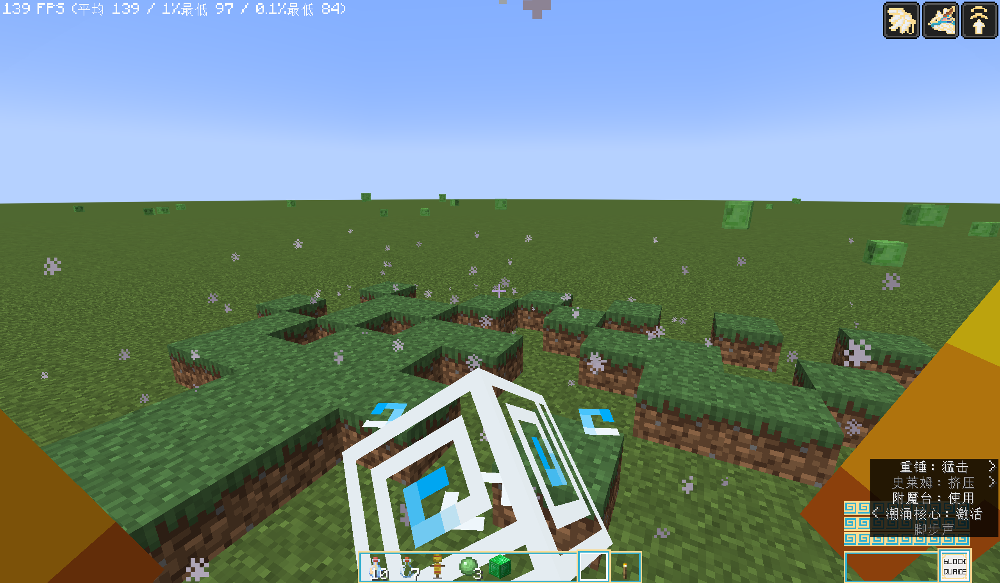
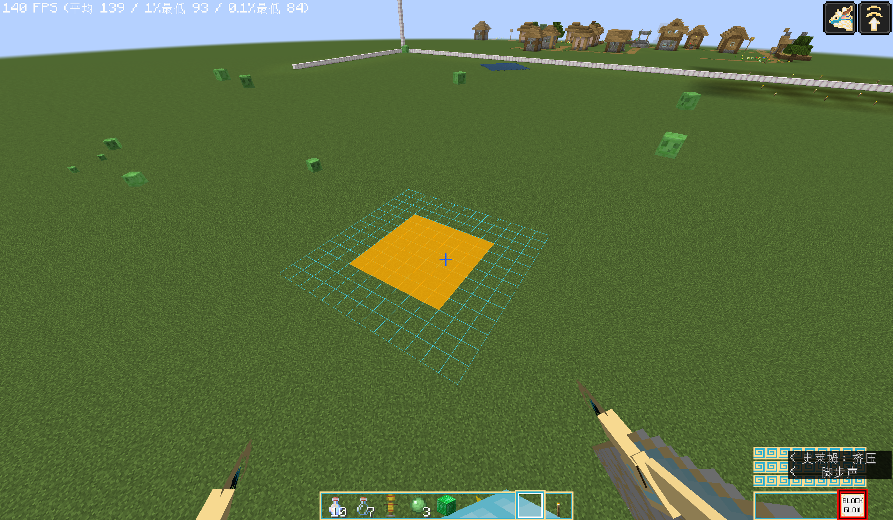

# 方块效果（block_effect）

> 适用：Additional Abilities for DS `2.0.0` · Dragon Survival `≥ 2.0.71`
> 相关：`actions[].target_selection.applied_effects.block_effect[]`

方块效果写在 `applied_effects.block_effect[]` 数组里，每个元素用 `effect_type` 指定类型，
该类型自己的字段与 `effect_type` **平级**：

```jsonc
"applied_effects": {
  "block_effect": [
    { "effect_type": "additional_abilities:block_quake", /* ← 字段写在这一层 */ }
  ]
}
```

---

## `additional_abilities:block_quake` 方块震动

**一句话**：让被选中的方块像被砸地掀起一样跳一下，再落回原位。



### 字段

| 字段 | 类型 | 必填 | 默认 | 说明 |
|---|---|---|---|---|
| `amplifier` | 等级数值 | ❌ | `0.5` | 高度倍率，见下方换算 |
| `probability` | 等级数值 | ❌ | `1.0` | 生效概率，**每个方块独立判定** |
| `valid_blocks` | 方块谓词 | ❌ | 全匹配 | 与 DS 其它方块效果同格式 |
| `sound` | 音效 id | ❌ | 无声 | 跃起时播放的音效。直接写注册 id 字符串，如 `"minecraft:item.mace.smash_ground"` |

### 高度换算

```
跃起高度（格） = min(3.0, 0.5 × amplifier)
```

| `amplifier` | 0.5 | 1.0 | 2.0 | 6.0 及以上 |
|---|---|---|---|---|
| 高度 | 0.25 格 | 0.5 格 | 1.0 格 | 3.0 格（封顶） |

跳跃时长随高度以 √ 关系增长（跳得越高耗时越长），自动钳制在 **6 ~ 24 刻**，不用手调。

### 示例

```json
"block_effect": [
  {
    "effect_type": "additional_abilities:block_quake",
    "amplifier": { "type": "minecraft:linear", "base": 0.5, "per_level_above_first": 0.25 },
    "probability": 0.35,
    "valid_blocks": { "type": "minecraft:matching_block_tag", "tag": "minecraft:dirt" },
    "sound": "minecraft:item.mace.smash_ground"
  }
]
```

### 用法要点

- **纯视觉，不改世界**。跃起的方块是客户端本地生成的假身，**不参与碰撞、不进存档、不掉落**，
  也没有邻接更新与光照变化。放心在大范围里用。
- **有筛选链**，被滤掉的方块不会动（顺序即开销顺序）：
  1. 概率判定；
  2. `valid_blocks` 谓词；
  3. 排除空气；
  4. **只保留满碰撞方块** —— 台阶、楼梯、火把、草、流体被抬起一整格时观感是错的，一并滤掉；
  5. **表层判定** —— 上方有遮挡（说明方块被埋住）、或上方是流体，都跳过。
- 第 4、5 条意味着：**水下与地下的方块不会跳**。这是有意的观感保护，不是 bug。
- `sound` 与 DS 技能 JSON 的 `activation.sound` 写法一致，直接写音效注册 id 即可；
  自定义音效只要已注册进 `minecraft:sound_event` 也能填。播放细节：
  - **每次技能动作只响一次**，声源取该批方块的**几何中心** —— 一次范围震动往往同时抬起几十个方块，
    逐方块播放等于几十个音源叠加，听感是爆音而不是「一下砸地」；
  - **「一批」按施法动作划分**：同一次施法落下的所有方块合为一处声源；
    不同玩家、不同技能、以及**同一玩家同一技能的两次独立施法**（例如两个并存的领域）
    同刻震动时**各自发声**，声源各自落在自己那片方块上。
    （视觉表现仍然是跨施法者合并的，两者互不影响 —— 相距很远的两处震动不会因为画面相同
    就把声源挪到两者中间，否则两边都听不到。）
  - 音量 / 音高固定为原版默认的 `1.0`（可听半径约 16 格），**不随 `amplifier` 变化**；
  - 服务端广播，**施法者本人也听得到**。
- **有内建限流**，不用担心高频 `trigger_rate` 把方块抖成鬼畜：
  - **位置冷却**：同一坐标 10 刻内只震一次；
  - 同一刻的触发会聚合成尽可能少的网络包，并按包围盒半径只发给附近的玩家。
  - 冷却记录与待发缓冲都挂在**每个维度自己的数据**上，随世界实例生灭 ——
    因此换存档后不会拿着上一个世界的时间戳判定冷却（否则新存档里同坐标的震动会被长期拒绝）。
- **换维度立即清理假身**：客户端一旦发现世界实例变了（换维度、退出到主菜单）就丢弃全部假身，
  **不依赖新维度是否发包**，所以旧坐标的假身不会留在旧世界里继续弹跳。
- 本效果只动「方块的外形」，**不产生伤害**。要配伤害请另加 `dragonsurvival:damage` 之类的实体效果，
  并注意用**另一个 action**（实体效果与方块效果不能写在同一个 `applied_effects` 里）。

---

## `additional_abilities:extinguish` 熄灭

**一句话**：把被选中的方块上**正在烧的东西**扑灭 —— DS 内置 `dragonsurvival:fire` 的反向版。

### 字段

| 字段 | 类型 | 必填 | 默认 | 说明 |
|---|---|---|---|---|
| `extinguish_probability` | 等级数值 | ❌ | `1.0` | **只作用于火焰方块**（`fire` / `soul_fire`）；营火与蜡烛无条件熄灭 |

### 能扑灭什么

判定顺序与原版喷溅水瓶的 `ThrownPotion#dowseFire` 完全一致，三者互斥（命中即返回）：

| 顺序 | 目标 | 行为 |
|---|---|---|
| 1 | 火焰：`minecraft:fire` / `minecraft:soul_fire`（`#minecraft:fire` 标签） | 按 `extinguish_probability` 移除方块（**不掉落**） |
| 2 | 点燃的蜡烛 / 蜡烛蛋糕 | 置 `lit=false`，烟雾粒子 + `CANDLE_EXTINGUISH` 音效 |
| 3 | 点燃的营火 / 灵魂营火 | 置 `lit=false`，停止烹饪（`CampfireBlockEntity#dowse`）+ `FIRE_EXTINGUISH` 音效 |

### 与 `dragonsurvival:fire` 的镜像关系

| `dragonsurvival:fire` 的分支 | `extinguish` 的对应 |
|---|---|
| TNT → 引爆 | **无** —— 已引燃的 TNT 无法取消 |
| 未点燃营火 → 点燃 | 已点燃营火 → 熄灭 |
| `snowy` 方块 → 除雪 | **无** —— 反向「加雪」与熄灭无关 |
| 空气位 + 概率 → 放火 | 火焰方块 + 概率 → 移除 |
| （无） | 蜡烛 / 蜡烛蛋糕 → 熄灭 **（本效果新增的一支）** |

结构同样对称：**只有「放火 / 灭火」这一支吃概率**，特殊分支不吃。

### 示例

```json
"block_effect": [
  {
    "effect_type": "additional_abilities:extinguish",
    "extinguish_probability": 1.0
  }
]
```

### 用法要点

- **原版没有「灭火 API」**。MC 1.21.1 里不存在能直接扑灭火焰方块的方法（`FireBlock` / `BaseFireBlock`
  都没有 `extinguish`），所以本效果照抄原版喷溅水瓶的处理方式，音效、粒子与 `BLOCK_CHANGE` 游戏事件都一致。
- 火焰用 `destroyBlock(pos, false, dragon)` 移除，**不掉落**（火焰本就没有战利品表）。
- **`direction` 不参与任何判定**，因此不受「`direction` 多为 null」的影响。
- 概率**不足 100%** 时才会在侧边栏追加「生效概率 x%」。
- 与内置效果的分工：`dragonsurvival:block_break` 只能拆火焰且无音效；`dragonsurvival:conversion` 只能按方块状态
  做一一映射（如营火→未点燃营火）。要「把一片区域的火全灭了」用本效果，一次覆盖火焰、营火与蜡烛。

---

## `additional_abilities:glow` 方块发光

**一句话**：让被选中的方块**发光** —— 视距内的**任何玩家**看到的都是同一处、同色、同时长的效果。



### 字段

| 字段 | 类型 | 必填 | 默认 | 说明 |
|---|---|---|---|---|
| `color` | 颜色 | ✅ | — | 原版 `TextColor`：16 个颜色名，或 `#RRGGBB`，见下 |
| `alpha` | `0.0` ~ `1.0` | ❌ | `1.0` | 不透明度。为 0 等于不可见，会被直接跳过 |
| `display_type` | 枚举 | ❌ | `outline` | `outline`（线框）/ `simple_shader`（整块染色） |
| `duration` | 等级数值 | ❌ | `60`（3 秒） | 发光时长（刻），自动钳制在 **1 ~ 1200** |
| `probability` | 等级数值 | ❌ | `1.0` | 生效概率，**每个方块独立判定** |
| `valid_blocks` | 方块谓词 | ❌ | 全匹配 | 与 DS 其它方块效果同格式 |
| `hide_occluded` | 布尔 | ❌ | `true` | 是否剔除被完全遮挡的方块。**只对 `simple_shader` 生效** |

### 颜色怎么写

| 写法 | 例子 |
|---|---|
| 颜色名（16 个，全小写） | `"aqua"` / `"dark_purple"` / `"light_purple"` / `"gold"` … |
| 十六进制 | `"#3FD9FF"` |

颜色名共 16 个：`black` `dark_blue` `dark_green` `dark_aqua` `dark_red` `dark_purple` `gold` `gray`
`dark_gray` `blue` `green` `aqua` `red` `light_purple` `yellow` `white`。

> ⚠️ **两个坑**：
> 1. `#` 分支是「按 16 进制**整数**解析」，**不是 CSS 简写** —— `"#FFF"` 是 `0x000FFF`（近乎黑的深蓝）而不是白色，
>    **必须写满 6 位**。
> 2. **`color` 本身不支持 alpha**（八位 `#AARRGGBB` 会超出范围直接报错），要半透明请用独立的 `alpha` 字段。

### 两种显示方式

| `display_type` | 观感 | 每块开销 | 施加的筛选 |
|---|---|---|---|
| `outline` | 沿方块描一圈棱线，像是方块自己在发光 | **恒定 12 条棱**，与方块形状无关 | 距离（64 格）+ 视锥 |
| `simple_shader` | 整个方块模型被染成该颜色 | 每帧烘焙一次方块模型，明显更贵 | 距离（32 格）+ 视锥 + **被遮挡 / 形状不完整的方块连包都不发** |

`outline` **开启深度测试**：被前面的方块挡住的部分不会显示 —— 是「方块自己在发光」，**不是透视**。

### 示例

```json
"block_effect": [
  {
    "effect_type": "additional_abilities:glow",
    "color": "#3FD9FF",
    "alpha": 0.85,
    "display_type": "outline",
    "duration": { "type": "minecraft:linear", "base": 40.0, "per_level_above_first": 20.0 },
    "valid_blocks": { "type": "minecraft:matching_block_tag", "tag": "minecraft:ores" }
  }
]
```

### 用法要点

- **和 `dragonsurvival:glow` 不是一回事**（本效果存在的理由）：
  - DS 的 `glow` 是**实体效果**，把状态挂在**玩家**身上，客户端只给**该玩家自己的龙模型**描边 ——
    位置跟着人走，而且只有本人看得见；
  - 本效果是**方块效果**，目标是方块坐标，由服务端同步给附近玩家 —— 位置固定在世界里，谁路过都看得见。
- **与 `dragonsurvival:block_vision`（矿石视觉）的关系**：DS 那套已经实现了 `outline` / `simple_shader`
  两种表现，但它是挂在玩家身上的**客户端本地扫描**，完全不经网络同步给其他人。本效果复用了它的**渲染表现**，
  换掉了它的**同步与生命周期语义**。
- **纯视觉，不改世界**：不调用 `setBlock`、不写光照数据、不产生方块更新 —— **不影响实际方块亮度**。
- **可以重叠**：不同颜色 / 不同显示类型在服务端是不同条目，客户端各自绘制，所以不同施法、不同玩家的效果
  自然叠加、互不顶替。（同色同类型会合并为一条 —— 视觉上本就无法区分。）
- **合并的是「显示」，不是「时长」**：同色同类型的多名施法者虽然共用一条，但**各自记着自己的到期时刻**，
  条目整体活到其中最晚的那一刻。因此：
  - 甲贡献 1200 刻、乙贡献 20 刻时，乙那笔在 20 刻就退场，不会拖着整条继续存在；
  - 用 `/additional-abilities block-glow clear` 清掉甲时，若乙早已过期，**整条会被真正移除**，
    指令返回的条数因此与实际消失的数量一致。
- **时长自管**：方块效果接口没有 `remove`（一律瞬时），因此时长由本效果自己维持 ——
  服务端每 20 刻把存活条目重发一次「续命」，客户端按包内剩余时长本地倒计时。
  技能持续触发时发光常亮，停止后自然过期。代价：**技能被提前打断时，发光会残留到 `duration` 结束**。
- **状态严格属于当前世界**：服务端的存活条目挂在**每个维度自己的数据**上，客户端则只在
  **当前世界实例**内保留条目 ——
  - **换存档不会串味**：条目随世界实例一起建立、一起回收，因此「先进时间较大的存档 A、退出、
    再进时间较小的存档 B」不会让 A 遗留的时刻影响 B（否则 B 里同坐标的新发光会长时间不显示）；
  - **换维度立即消失**：客户端一旦发现世界实例变了（换维度、退出到主菜单）就整表作废，
    **不依赖新维度是否发包**，所以旧坐标的发光不会继续画、也不会继续倒计时。
- **遮挡筛选只为 `simple_shader` 服务**：判定口径是「6 个邻接方块是否**全部**实心渲染」——
  这是严格意义上的完全遮挡，不会误剔可见方块。`outline` 不做这项筛选：它的代价与是否可见无关，
  而开启深度测试后 GPU 会免费把被挡住的棱处理掉。要做「透视找矿」类效果时把 `hide_occluded` 设为 `false`。
- **侧边栏说明**：概率不足 100%、`alpha` 低于 1.0、或 `valid_blocks` 不是全匹配时，才会追加对应说明。
### 客户端配置（可见距离）

发光**画到多远**是客户端设置，落在 `config/additional_abilities-client.toml` 的 `[block_glow]` 分区，
也可以在游戏内「模组 → Additional Abilities for DS → 配置」里直接改，**改完即时生效、无需重启**。

| 配置项 | 默认 | 说明 |
|---|---|---|
| `block_glow.outline_distance` | `64.0` | 线框通道的可见距离（格），范围 `8 ~ 64` |
| `block_glow.shader_distance` | `32.0` | 整块染色通道的可见距离（格），范围 `8 ~ 64`。**掉帧时优先调小它** |

两点要注意：

- **上限 64 不是随手定的**：服务端按固定余量决定"把发光包发给谁"，而它<b>读不到</b>客户端这份配置
  （客户端配置在专用服务端根本不加载）。所以配置上限被直接钉在服务端的广播余量
  （`BlockGlows.VIEW_MARGIN`）上 —— **只能调小、调不大**，这样结构上就配不出
  「客户端想画、服务端却没发包」的静默截断。
- 调小它只影响**你自己看到的画面**，不影响其他玩家，也不影响发光时长与服务端行为。

---

## `additional_abilities:redstone_powering` 红石供能

**一句话**：给被选中的方块一次**虚拟红石输入** —— 红石线、继电器、灯、活塞等原版元件照常工作，世界里却不会出现任何红石源方块。

### 字段

| 字段 | 类型 | 必填 | 默认 | 说明 |
|---|---|---|---|---|
| `power` | 等级数值 | ✅ | — | 红石信号强度，四舍五入后钳制到 **0 ~ 15** |
| `target_direction` | 方向 | ❌ | 省略 = 直接激活 | 复用 DS 的 `TargetDirection`，见下 |
| `probability` | 等级数值 | ❌ | `1.0` | 生效概率，**每个目标方块独立判定** |
| `valid_blocks` | 方块谓词 | ❌ | 全匹配 | 效果自身的方块过滤；仍先经过 DS 的 `target_conditions` |
| `pulse_duration` | 等级数值 | ❌ | `1` 刻 | 供能时长，钳制到 **1 ~ 20** 刻 |

### `target_direction` 怎么写

```json
"target_direction": { "direction": "north" }          // 固定方向
"target_direction": { "direction": "looking_at" }     // 施法者视线最近轴
"target_direction": { "direction": "towards_entity" } // 目标方块指向施法者
```

省略 `target_direction` 即“无方向直接激活”。

设目标方块为 `P`、方向为 `D`，虚拟信号源在 `S = P.relative(D)` —— 也就是“信号从 `D` 那一侧输入”。

| JSON | 运行时 `D` | 含义 |
|---|---|---|
| `"north"` / `"south"` / `"east"` / `"west"` / `"up"` / `"down"` | 该方向 | 固定从这一面输入 |
| `"looking_at"` | `Direction.getNearest(施法者视线)` | 从施法者看的方向输入 |
| `"towards_entity"` | 目标方块中心 → 施法者眼睛的最近轴 | 从朝向施法者的一面输入 |
| 省略 | — | 不建立虚拟源，只做一次邻居更新 |

> `apply` 的 `direction` 形参是 DS 视线目标给出的**命中面**，与 `target_direction` 是两套概念；本效果**不**把它当作输入方向。

### 两种模式

**1. 有方向：虚拟红石输入**

- 在 `S` 上登记一笔 `power` 强度的贡献；`SignalGetter` 的 `getSignal(S, D)` / `getDirectSignal(S, D)` /
  `getControlInputSignal(S, D, false)` 返回 `max(真实值, 虚拟值)`，真实红石不会被覆盖
  （最后一条覆盖比较器的**侧面输入**；中继器锁定只接受真正的二极管，见下表）；
- 随后通知 `S` 周围的方块：`S` 与六个邻居都在已加载区块内时走原版
  `updateNeighborsAt(S, Blocks.REDSTONE_BLOCK)`；位于区块边界或源区块已卸载时只对目标 `P` 补一次
  `neighborChanged`，不会为通知强行加载邻块；
- 红石线优先级、继电器 / 比较器延迟、铜灯、活塞、发射器、铁轨等全部由原版代码决定；
- 同一 `(S, D)` 上可以有多笔贡献（不同玩家 / 不同技能），**读取取仍存活的最高强度，逐笔独立到期**。

**2. 无方向：直接激活**

只对 `P` 调用一次原版 `neighborChanged(P, Blocks.REDSTONE_BLOCK, P)`，不建立 `S` 处的源。
若 `P` 是导电方块，还会按下面的“方块充能”处理；对非导电目标，这不是“六面同时输入 `power`”，
也**不是**模拟玩家右键。按钮、拉杆、压力板、绊线等需要玩家 / 实体交互的方块不会被按下。

> 第三个参数（`neighborPos`）传的是 `P` 自身而不是 `null`：1.21.1 的 `CollectingNeighborUpdater`
> 会对该参数调用 `immutable()`，传 `null` 会直接 NPE。传自身是“没有具体来源面”时语义上最中性的选择。

**3. 方块充能（目标本身是导电方块时，与上面两种模式叠加）**

若 `P` 满足原版的 `state.isRedstoneConductor(level, P)`（原木、铁块、石头等满碰撞的导电方块），
则**无论有没有 `target_direction`**，`P` 本身都会在 `pulse_duration` 内被充能：

- `getSignal(P, 任意面)` / `getDirectSignal(P, 任意面)` / `getControlInputSignal(P, 任意面, false)`
  返回 `max(真实值, power)` —— 即 `P` 向六个面放能；
- 建立 / 撤销时对 `P` 的六个邻居补发邻居更新，贴着 `P` 的中继器、红石火把、灯等会重新求值；
- 有方向时，`S` 处的源供能仍会建立，因此“`P` 向四周放能”和“`P` 自身作为消费者被读取”可以同时存在；
- 方块充能不改变 `P` 的真实方块状态，所以不会触发观察者；无方向模式下的红石灯会被充能，
  但灯读的是邻居而不是自己，不会因此点亮 —— 要让它亮，请给一个方向，让它同时获得 `S` 处的源。

非导电目标（空气、中继器、比较器等）不建立方块充能。

### 能生效的方块

通过“虚拟信号 + 原版邻居更新”覆盖遵守 1.21.1 `SignalGetter` / 邻居更新契约的原版方块，例如：

红石线、红石火把、红石灯、铜灯泡、音符盒、TNT、门 / 活板门 / 栅栏门、活塞 / 粘性活塞、
发射器 / 投掷器 / 合成器 / 命令方块、中继器 / 比较器（含比较器侧面输入）、铁轨类，以及其它经
`hasNeighborSignal` / `getSignal` / `getDirectSignal` / `getControlInputSignal` 检查输入的方块。

另外，**原木、铁块、石头等导电方块**作为目标时，它自身会被充能并向六个面放能（无方向也生效），
贴着它的中继器 / 红石火把 / 灯等因此能读到信号。

这些方块的状态、音效、游戏事件、方块实体与延迟仍由原版决定 —— 本效果只提供“可查询的输入值”。

### 需要单独说明的方块

| 方块 | 行为 |
|---|---|
| 观察者 | 观察者听**形状更新**而不是普通 `neighborChanged`。本效果会在 `P` 正好观察 `S` 时补一次 `neighborShapeChanged`；建立与撤销各一次（等价于“`S` 处出现 / 消失了一个方块”），1 刻脉冲会因原版 scheduled-tick 去重只输出一次脉冲 |
| 按钮 / 拉杆 / 压力板 / 绊线 | 是红石源或依赖玩家 / 实体交互，**不会**被本效果按下 |
| 红石火把 | 作为源时，只在方向与其实际输入面匹配时生效；虚拟信号只存在于指定的 `(S, D)`。目标方块被方块充能时，贴着它的火把按原版自身规则响应 |
| 可充能方块（原木 / 铁块 / 石头…） | 目标满足 `isRedstoneConductor` 时，无论有无方向都会成为虚拟充能方块：向六面放能并通知它的六个邻居；方块本身的状态不变（观察者不会触发） |
| 比较器 | 主输入覆盖 `getSignal` / `getDirectSignal`；**侧面输入**覆盖 `getControlInputSignal(..., false)` —— 把 `target_direction` 指向比较器的一个侧面即可；比较器自己的方块实体行为不变 |
| 中继器 | 主输入覆盖 `getSignal`。**锁定**在 1.21.1 只接受真正二极管（中继器 / 比较器）的 direct signal —— 虚拟源是“红石块式”的普通源，单独放置不会锁住中继器（与原版红石块一致） |
| 发射器 / 合成器 / 命令方块 / TNT | 会产生物品、命令或爆炸等真实副作用；请用 `valid_blocks` / `target_conditions` 限制目标 |
| 自定义红石方块 | 只保证遵循 `SignalGetter` / 邻居更新契约的实现；直接读自己 capability、BlockEntity 或事件的不保证被识别 |
| 红石实验特性 | 不手动设置红石线 `POWER`，当前世界的 evaluator 原样运行 |

### 参数与限制

- `power`：`Math.round` 后钳制到 `0 ~ 15`；`0` 不建立虚拟源 / 方块充能（也不会触发边沿通知）。
  无方向模式下仍必须写：对导电目标它决定方块充能强度，对非导电目标只作为 schema 完整性字段。
- `pulse_duration`：`1 ~ 20` 刻（含登记刻）。`1` 刻只覆盖登记它的那一刻；`20` 刻是避免被动技能长期供能的硬上限。
- **方块充能**：只对 `isRedstoneConductor` 的目标建立；充能不改变方块状态（不触发观察者）；
  无方向时红石灯等“读邻居”的方块不会因自身被充能而点亮。
- **不放置假方块**：`Blocks.REDSTONE_BLOCK` 只作为邻居更新回调的 `changedBlock` 标识，永不写入世界。
- **不主动加载区块**：目标或虚拟源所在区块未加载时本次触发直接跳过。
- **区块边界**：通知前会检查 `S` 的六个邻居是否都已加载；只要有一个未加载（或 `S` 本身已卸载），就降级为
  “只通知目标 `P`”，避免 `updateNeighborsAt` 通过 `getBlockState` 强行加载邻块。若 `P` 所在区块也已卸载，
  本次关断边沿会被跳过，等区块重新加载后由原版加载更新处理其状态。
- **不手改红石线**：不复制 `RedStoneWireBlock` / `DiodeBlock` 算法，交给原版与 `CollectingNeighborUpdater` 的 512 更新上限。
- **状态不持久化**：虚拟供能挂在当前 `ServerLevel` 的运行时数据上，服务端重启后自然消失；不会跨存档 / 跨维度残留。

### 示例

最小（无方向）：

```json
"block_effect": [
  {
    "effect_type": "additional_abilities:redstone_powering",
    "power": 15
  }
]
```

完整（向上供能 2 刻，只作用于红石灯）：

```json
"block_effect": [
  {
    "effect_type": "additional_abilities:redstone_powering",
    "power": { "type": "minecraft:linear", "base": 5.0, "per_level_above_first": 5.0 },
    "target_direction": { "direction": "up" },
    "pulse_duration": 2,
    "probability": 0.5,
    "valid_blocks": { "type": "minecraft:matching_blocks", "blocks": ["minecraft:redstone_lamp"] }
  }
]
```

### 用法要点

- 每次 `apply` = 一次脉冲；被动技能 / `area` 目标每刻触发时，信号在触发期间连续保持，停止触发后按 `pulse_duration` 自然消散。
- 同一施法者 + 技能的重复登记只续命（取较晚到期、较高强度），不会在同一 tick 重复排队相同更新。
- 聚合值未变化的边沿不广播；长脉冲期间不会每刻通知一遍下游元件。
- 生效完全在服务端；客户端只会看到原版方块状态变化（灯亮、门开等），不需要任何额外同步。
- **延迟元件**：红石线、继电器、比较器等要等到自己的延迟 tick 才重读输入，`1` 刻脉冲通常等不到 ——
  这类场景请把 `pulse_duration` 设为 **2 刻以上**（继电器 / 比较器往往还要再长一点）。
  红石灯 / 音符盒 / 铜灯泡的**亮起 / 发声 / 翻转**发生在邻居更新当刻，`1` 刻也能看到。
- 这是**红石供能**，不是通用方块交互：不要指望用它触发按钮、拉杆或玩家右键类逻辑。


